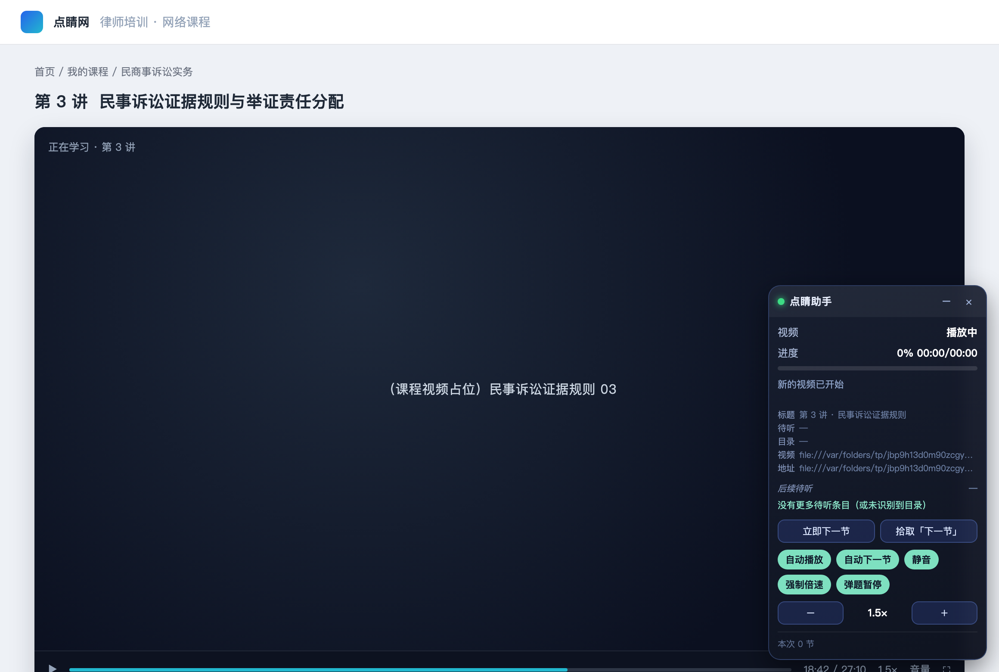
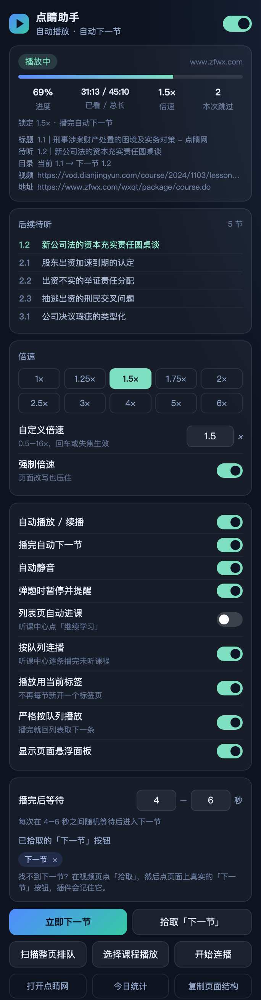

# 点睛网 · 自动刷课助手

[](https://github.com/huandc/dianjing-zhuke/actions/workflows/test.yml)

一个 Chrome（Manifest V3）扩展：在**点睛网**（`www.zfwx.com`）/ 新版**点睛云**（`www.dianjingyun.com`）听课时，自动播放视频、静音、按设定倍速播放，一节播完自动进入下一节；遇到弹题/测验会自动暂停并提醒你手动作答。





## 安装

1. 打开 Chrome，地址栏输入 `chrome://extensions/`；
2. 右上角打开「开发者模式」；
3. 点「加载已解压的扩展程序」，选择本目录 `dianjing-zhuke/`；
4. 列表里出现「点睛网 · 自动刷课助手」即安装完成；建议把图标固定到工具栏。

> 需要 Chrome 110+。也可以直接拖 `dist/dianjing-zhuke-v1.0.0.zip` 解压后再加载解压目录。

## 使用

1. 登录点睛网，进入要听的课程，点播放（第一次仍需你手动点一下，之后由插件接管）；
2. 页面右下角会出现悬浮面板，显示「播放中 / 进度 / 倍速 / 本次跳过」；
3. 点工具栏图标打开弹窗，按需要调整倍速、播完等待时间、自动下一节等开关。

默认行为：自动播放/续播 · 1.5 倍速 · 自动静音 · 播完在 4–6 秒内随机等待后进下一节 · 弹题暂停提醒 · 显示悬浮面板。

## 新版点睛云：右侧目录模式

新版播放页（`www.dianjingyun.com`）没有「下一节」按钮，课程是以右侧 **目录** 列表的形式给出的（条目形如 `1.2 | 公司法的…`）。插件会自动：

1. 从页面标题 / 面包屑 / 当前高亮的条目（例如「问题一」）推断你正在听的节号；
2. 在目录里找到下一个节号的条目并点击它；
3. 如果推断失败（标题里没有节号、也没有高亮项），就退回用「下一节」文案扫描，仍未找到时用**拾取**指定一次即可。

## 找不到「下一节」按钮？

点睛网的按钮样式可能和插件内置的文案规则不一致，这时用「拾取」：

1. 弹窗里点 **拾取「下一节」**（或悬浮面板上的同名按钮）；
2. 页面会出现绿色高亮框，点一下**真实的「下一节」按钮**（Esc 可取消）；
3. 插件会记住这个按钮（按域名保存，最多 5 条），之后优先点它。

拾取到的选择器会显示在弹窗的「已拾取的下一节按钮」标签里，点标签上的 `×` 可删除。

## 选项说明

| 选项 | 默认 | 说明 |
| --- | --- | --- |
| 总开关 | 开 | 关掉后插件不做任何操作（悬浮面板保留显示） |
| 倍速 | 1.5× | 可选 1–3×；对正在播放的 `<video>` 生效 |
| 锁定倍速 | 开 | 播放器在切清晰度/seek 后把倍速重置回 1× 时，自动拉回设定值 |
| 自动播放 / 续播 | 开 | 视频暂停时自动播（浏览器拦截自动播放时会提示你手点一次） |
| 播完自动下一节 | 开 | 优先点右侧目录里的下一节（`1.2 | …`），否则识别「下一节/下一讲/继续学习…」按钮 |
| 自动静音 | 开 | 关掉这个开关会把声音恢复回去 |
| 弹题时暂停并提醒 | 开 | 命中「答题/测验/考试/提交答案…」类弹层时暂停视频，避免把题跳过去 |
| 列表页自动进课 | 关 | 在听课中心点「继续学习」进下一门课，容易误点，默认关闭 |
| 显示页面悬浮面板 | 开 | 右下角面板，可拖动，位置会记住 |
| 播完后等待（区间） | 4–6 秒 | 自填最短/最长秒数（0–300），每次在区间内随机取一个值；模拟正常观看节奏，避免固定间隔切太快 |

## 常见问题

**装好后页面没有面板？**
确认地址是 `www.zfwx.com` 或 `www.dianjingyun.com` 下的页面；已打开的标签页需要刷新一次；或在弹窗里点「在当前页注入」手动注入。

**为什么每次跳到下一节的时间都不一样？**
「播完后等待」是一个区间：插件在最短/最长秒数之间随机取一个值（默认 4–6 秒），看起来更像真人正常听课。想要固定间隔，把两个数字填成一样即可（如都填 5）。

**点了下一节但视频没换？**
说明识别到的按钮不是真正的切换按钮：用「拾取」重新指定。面板状态里会提示重试。

**倍速被改回 1×？**
打开「锁定倍速」。

**视频没声音？**
关掉「自动静音」，插件会恢复音量（默认会静音，方便后台挂着刷）。

**视频在 iframe 里？**
插件对所有 frame 注入，并会把子框架里的状态汇总到弹窗；只有**点睛网域名下的 iframe** 才注入。如果是第三方播放器的跨域 iframe，需要在 `manifest.json` 的 `host_permissions` / `content_scripts.matches` 里补上对应域名。

**弹题/考试能自动答吗？**
不能，也不打算做。插件只会暂停并提醒，答题与考试请自己完成。

**今日统计是什么？**
后台 Service Worker 统计「今天自动跳过的节数」，只存在本机 `chrome.storage.local`。

## 工作原理（简述）

- `src/content.js` 注入每个 zfwx.com / dianjingyun.com 页面：找面积最大/正在播放的 `<video>`，每 1 秒校正一次播放状态与倍速；
- 识别「下一节」：优先用你拾取的选择器；其次按右侧目录的节号（`1.2 | …`）找当前项的下一项；最后按内置文案（下一节/下一讲/下一课/继续学习…）扫描可见元素；
- 视频 `ended` 或剩余时长 ≤1.5 秒时，在「播完等待」区间内随机等一会儿再点击下一节，视频没换会最多重试 3 次；
- 弹层检测：命中测验类关键词 → 暂停 + 提示音；普通提示框（继续播放/确定）→ 自动点掉；
- `src/background.js` 汇总各标签页/frame 状态、维护角标（ON）与今日统计，并把弹窗里的命令路由到真正有视频的 frame；
- 悬浮面板用 Shadow DOM 隔离样式，可拖动，位置写入 `chrome.storage.local`。

## 隐私

所有设置与统计只保存在本机浏览器里（`chrome.storage.local`），插件不发起任何外部网络请求，也不采集账号、课程内容或答题信息。申请权限仅：`storage`（存设置）、`scripting`+`activeTab`（手动注入脚本），主机权限仅 `*://*.zfwx.com/*` 与 `*://*.dianjingyun.com/*`。

## 免责声明

本插件用于个人学习时的播放自动化（自动播放、自动翻页、倍速），**不破解、不代答、不伪造学习记录**。使用前请确认符合点睛网/所在单位的学习规则；因使用本插件产生的账号风险或学习时长不被认定等问题，由使用者自行承担。

## 开发与测试

```bash
npm install          # 只装 jsdom，测试用
npm test             # 后台逻辑 11 项 + 内容脚本 19 项

# 单独跑
node test/background.test.mjs
node test/smoke.test.mjs

# 没有 node_modules 时可指定 jsdom 路径
JSDOM_PATH=/path/to/node_modules/jsdom node test/smoke.test.mjs

# 重新生成界面截图 / 图标（截图需要本机 Chrome）
npm run preview
npm run icons
```

测试覆盖：面板注入、自动播放/静音/倍速、锁定倍速回拉、静音恢复、「下一节」识别与自动点击、跳过节数上报、随机等待区间与旧设置迁移、弹题暂停、设置联动、拾取优先级、目录模式（含高亮小节反推章节）、后台状态汇总/命令路由/统计与清理（共 38 项断言）。

目录结构：

```
manifest.json          MV3 清单
src/content.js         内容脚本（播放控制 / 按钮识别 / 悬浮面板 / 拾取）
src/background.js      Service Worker（状态汇总 / 角标 / 统计 / 命令路由）
src/popup.html|css|js  工具栏弹窗
icons/                 16/48/128 图标
test/                  jsdom 冒烟测试 + 后台单元测试
tools/                 图标生成、界面截图脚本
docs/                  截图
```

## 许可

[MIT](LICENSE) © 2026 huandC

免责声明见上：仅用于个人学习场景的播放自动化，请遵守点睛网及所在单位的学习规则。
