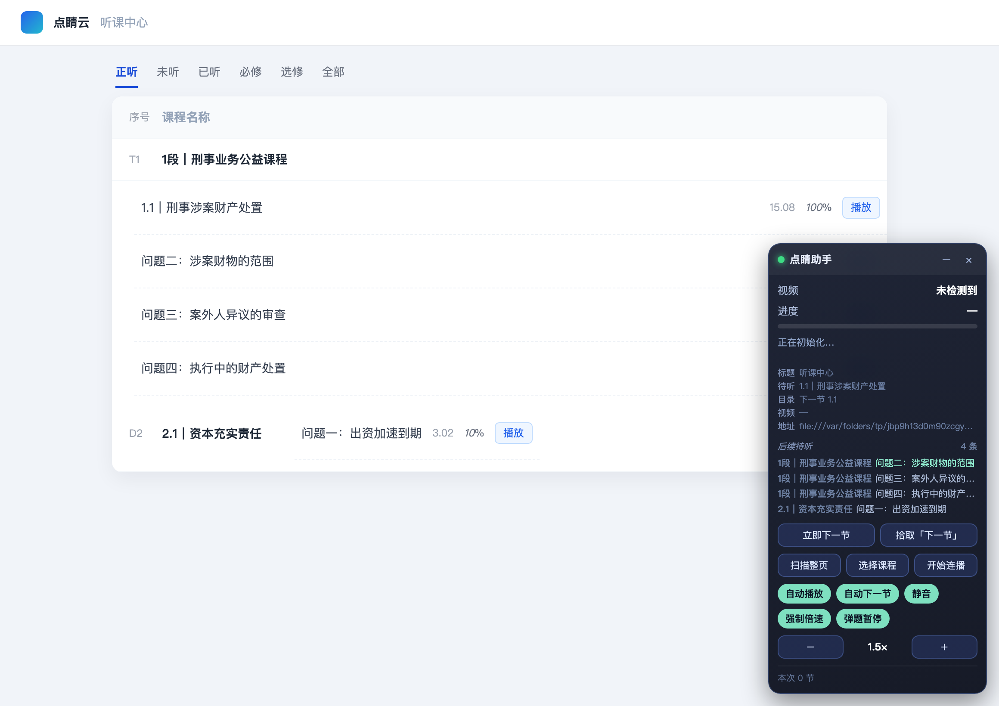

# 点睛网 · 自动刷课助手

[](https://github.com/huandc/dianjing-zhuke/actions/workflows/test.yml)

一个 Chrome（Manifest V3）扩展：在**点睛网**（`www.zfwx.com`）/ 新版**点睛云**（`www.dianjingyun.com`）听课时，自动播放视频、静音、按设定倍速播放，一节播完自动进入下一节；遇到弹题/测验会自动暂停并提醒你手动作答。


## 安装

1. 打开 Chrome，地址栏输入 `chrome://extensions/`；
2. 右上角打开「开发者模式」；
3. 点「加载已解压的扩展程序」，选择本目录 `dianjing-zhuke/`；
4. 列表里出现「点睛网 · 自动刷课助手」即安装完成；建议把图标固定到工具栏。

> 需要 Chrome 110+。也可以直接拖 `dist/dianjing-zhuke-v1.0.0.zip` 解压后再加载解压目录。

## 使用

1. 登录点睛网，进入要听的课程，点播放（第一次仍需你手动点一下，之后由插件接管）；
2. 页面右下角会出现悬浮面板，显示「播放中 / 进度 / 倍速 / 本次跳过」；
3. 点工具栏图标打开弹窗，按需要调整倍速、播完等待时间、自动下一节等开关。

默认行为：自动播放/续播 · 1.5 倍速 · 自动静音 · 播完在 4–6 秒内随机等待后进下一节 · 弹题暂停提醒 · 显示悬浮面板。

## 右侧目录模式（新版播放页）

新版播放页没有「下一节」按钮，课程在右侧 **目录** 里。插件按两级策略自动点下一节：

1. **真实结构优先**：点睛网播放页的目录是 `.play_playerMLBox .courseItem`，章节标题 `h3.courseName`（形如 `1.1｜刑事涉案财产处置…`），下面 `ul.rightCatalogList > li.hasBuy` 是小节行；正在播放的带 `.on` / `data-status="bofang"`。插件直接找当前行的下一条 `li`（或下一个 `courseItem` 的标题）并点击，不依赖文案或猜测。
2. **通用兜底**：其他布局下，从页面标题 / 面包屑 / 高亮小节（如「问题一」）推断节号，找目录里下一个节号；再不行才用「下一节/继续学习」文案扫描。

**章节是折叠的**：如果下一章的列表还没展开，插件会先点章节标题把列表展开，约 0.9 秒后再点里面的第一条小节；目录是滚动懒加载时，还会先把目录容器滚到底触发加载，下一次检查再点。

都不行时用**拾取**指定一次即可，手动拾取始终最优先。

## 识别结果可视化

悬浮面板和弹窗状态卡里都会显示插件「看到」的内容，方便和页面比对：

- **标题**：`document.title`；
- **待听**：下一节要听的条目文本，例如 `1.2｜新公司法的资本充实责任圆桌谈`（折叠章节时是章节标题）；
- **目录**：`当前 1.1 → 下一节 1.2`（识别不出时显示 —）；
- **视频**：当前播放器的视频地址（`<video>` 的 `currentSrc`，HLS 时是 `.m3u8`）；
- **地址**：当前页面 URL。

面板和弹窗还各有一块「**后续待听**」列表，按右侧目录的播放顺序列出当前节之后的所有条目（编号 + 标题，去掉时长尾巴），第一行就是下一次会跳过去的条目；条数多时列表内部滚动，标题悬停可看全文。列表为空通常意味着识别不到目录（比如目录还在懒加载），此时「目录」一行也会是 `—`。

## 找不到「下一节」按钮？

点睛网的按钮样式可能和插件内置的文案规则不一致，这时用「拾取」：

1. 弹窗里点 **拾取「下一节」**（或悬浮面板上的同名按钮）；
2. 页面会出现绿色高亮框，点一下**真实的「下一节」按钮**（Esc 可取消）；
3. 插件会记住这个按钮（按域名保存，最多 5 条），之后优先点它。

拾取到的选择器会显示在弹窗的「已拾取的下一节按钮」标签里，点标签上的 `×` 可删除。

## 选项说明

| 选项 | 默认 | 说明 |
| --- | --- | --- |
| 总开关 | 开 | 关掉后插件不做任何操作（悬浮面板保留显示） |
| 倍速 | 1.5× | 一键档位 1/1.25/1.5/1.75/2/2.5/3/4/5/6×，另有「自定义倍速」可填 0.5–16×；对页面里所有 `<video>` 生效 |
| 强制倍速 | 开 | 在页面世界接管 `playbackRate`：播放器切清晰度/seek/换视频后把倍速写回 1×，也会立刻压回设定值 |
| 自动播放 / 续播 | 开 | 视频暂停时自动播（浏览器拦截自动播放时会提示你手点一次） |
| 播完自动下一节 | 开 | 优先点右侧目录里的下一节（`1.2 | …`），否则识别「下一节/下一讲/继续学习…」按钮 |
| 自动静音 | 开 | 关掉这个开关会把声音恢复回去 |
| 弹题时暂停并提醒 | 开 | 命中「答题/测验/考试/提交答案…」类弹层时暂停视频，避免把题跳过去 |
| 列表页自动进课 | 关 | 在听课中心点「继续学习」进下一门课，容易误点，默认关闭 |
| 显示页面悬浮面板 | 开 | 右下角面板，可拖动，位置会记住 |
| 播完后等待（区间） | 4–6 秒 | 自填最短/最长秒数（0–300），每次在区间内随机取一个值；模拟正常观看节奏，避免固定间隔切太快 |

## 只听一门课：选课程名，播完它下面的所有小节

不想扫整页？点弹窗的「**选择课程播放**」（面板上是「选择课程」），页面顶部会出现黄色提示条，然后**直接点页面上那门课的名称**即可：

- 套课（`T2 1段｜…`）→ 收它下面**所有子课**的全部「问题X」；
- 单课（`1.1｜…`）→ 只收这一门课的视频；
- 队列立刻换成这门课，并从第一节开始播；**已经听完（进度 100%）的根本不进队列**，提示里会告诉你「另有 N 节已听完，未放进队列」；如果这门课全听完了，就直接提示「都听完了，没有要播的」，不会建队列；
- 播到这门课最后一节时队列就空了，插件提示「待听队列已全部播完」，不会跳到别的课；
- 选错了再点一次「选择课程播放」重选即可，Esc 可取消选择。



## 听课中心：按队列连播（一次性扫整页）

在「听课中心 / 我的课程」这类列表页（`.courseList` 结构，Angular 渲染），插件可以：

1. 点弹窗里的「**扫描列表排队**」（或面板上的同名按钮）：插件会逐个点开套课/课件，让 Angular 把每个课程的「问题一、问题二…」拉出来，然后读取每条的 `.progress_num`；
2. 把**进度不是 100%** 的条目按页面顺序放进待听队列（存在 `chrome.storage.local` 的 `djzk_queue`，刷新不丢）；
3. 打开「按队列连播」后，列表页会自动点队列第一条的「播放」进入播放页；
4. 播放页里先按右侧目录一节节往下听（见上一节），**听到本课程最后一节**时自动回列表、接着点队列里的下一条，直到队列清空。

细节：

- 每次都是**回到列表页重新读一次进度**再点下一条，所以已经听满 100% 的会被自动跳过，不会重复点；
- 队列里找不到对应行（比如换了筛选页签）会自动标为跳过并提示；
- 「开始连播」按钮用于手动触发当前队列的下一条，不用等自动判断；
- 面板/弹窗的「后续待听」在列表页显示的就是这个队列（`课程 · 问题X` 形式）。

## 想要更快？

面板/弹窗的档位一路开到 **6×**；再快就在弹窗的「自定义倍速」里填（0.5–16×，回车或失焦生效），底层是标准的 `video.playbackRate`，Chrome 支持到 16×。

几点实际影响：

- **4× 以上音频基本只能听出“快进”**，人声已经难以分辨，建议配合「自动静音」；
- 高倍速下插件把结尾判定窗口按倍速放大，并缩短轮询到 600ms，不会因为跑得太快而错过结尾；
- 站点如果按 `timeupdate` 计时长，倍速播放仍会照常累计，但**有些课程平台会校验实际观看时长**（例如要求 1× 下的真实分钟数），这种情况下高倍速可能不计入有效学时，自己权衡。

## 常见问题

**装好后页面没有面板？**
确认地址是 `www.zfwx.com` 或 `www.dianjingyun.com` 下的页面；已打开的标签页需要刷新一次；或在弹窗里点「在当前页注入」手动注入。

**为什么每次跳到下一节的时间都不一样？**
「播完后等待」是一个区间：插件在最短/最长秒数之间随机取一个值（默认 4–6 秒），看起来更像真人正常听课。想要固定间隔，把两个数字填成一样即可（如都填 5）。

**站点禁用了 F12 / 无法打开开发者工具？**
不用 F12 也能排查：点工具栏的扩展图标，在弹窗底部点「复制页面结构」，会把当前页的标题、右侧目录条目和高亮项的 DOM 片段复制到剪贴板（复制失败时会显示在下方的文本框里，手动全选复制即可）。另外 F12 通常只是被网页拦了键盘事件，用菜单「更多工具 → 开发者工具」或 `Cmd+Opt+I` / `Ctrl+Shift+I` 一般仍能打开。

**播完了但没自动跳下一节？**
按面板提示排查：①「自动下一节未开启」→ 把开关打开；②「没找到「下一节」按钮」→ 用「拾取」指定一次；③「点击下一节：目录 1.2」但视频没换 → 目录条目可能在折叠章节里（v1.4.1 起会严格判断高度与 `overflow:hidden`，先点章节标题再点小节），也可能是播放器拦截了合成点击，用「拾取」后仍不行就把「复制页面结构」发我；④ 面板什么都没变 → 结尾没被识别，v1.4.1 起同时用 `ended` 事件、按倍速放大的结尾窗口和「进度回跳」（播放器播完把 `currentTime` 归零）三种方式判断，轮询也加密到 600ms。

**点了下一节但视频没换？**
说明识别到的按钮不是真正的切换按钮：用「拾取」重新指定。面板状态里会提示重试。

**为什么每跳一节就多一个标签页，最后 Chrome 里堆一堆？**
点睛网的「播放」按钮内部是 `window.open(...)`，所以在列表页每点一次就开一个新标签。v1.8.0 起，插件在**页面世界**注入 [src/same-tab.js](src/same-tab.js)，在连播期间把同源的 `window.open` 改写成 `location.href`（当前标签内跳转），并返回一个「假 window」防止站点代码 `window.open(...).focus()` 报错：

- 只在「按队列连播」生效、且当前是课程列表页时才接管，平时你手动点播放不受影响；
- 只接管**同源**地址，支付/客服等第三方弹窗照常新开；
- 弹窗里新开关「**播放用当前标签**」可以随时关掉这个行为；
- 如果站点某些地方用 `<a target="_blank">` 而不是 `window.open`，仍会新开标签——遇到就先把「按队列连播」关掉手动播，并把页面结构发我。

**队列连播时一直在反复打开页面、同一节循环？**
v1.7.1 起加了三道刹车：① 同一条刚点过（10 分钟内）不会再点第二次，面板会显示「已打开，等它播完」；② 同一条点了 2 次还是没播起来，自动标为跳过并继续下一条；③ 刚打开播放页 15 秒内不允许「回列表继续」，避免「打开→立刻回列表→再打开」的空转；④ 页面里只要已经有视频在播（哪怕列表还在），就不会再点列表里的「播放」。

如果仍然在同一节打转，通常是**服务端进度还没同步**（页面 `.progress_num` 仍是旧值），此时插件无法判断它已经听完。处理办法：刷新列表页让它重新读进度，或在面板上点「开始连播」手动推下一条；排查时也可先关掉「按队列连播」，只保留手动「开始连播」。

**倍速被改回 1×？**
确认「强制倍速」是开着的（默认开）。它是真强制：内容脚本通过 `world: "MAIN"` 在**页面世界**注入 [src/rate-lock.js](src/rate-lock.js)，在播放器代码之前接管 `HTMLMediaElement.prototype.playbackRate`，并给每个 `<video>` 再定义一次实例属性——页面自己写 `video.playbackRate = 1` 也会被改写回目标倍速；`ratechange / play / loadedmetadata / seeked` 事件和每秒一次的兜底检查会再拉一次。

注意两点：① 强制开启后，用播放器自带的倍速菜单改速度也会被压回，想临时改就用弹窗/面板上的倍速按钮；② 需要 Chrome 111+（`world: "MAIN"` 的最低版本），更老的浏览器会退回「每秒拉一次」的弱模式。

**视频没声音？**
关掉「自动静音」，插件会恢复音量（默认会静音，方便后台挂着刷）。

**视频在 iframe 里？**
插件对所有 frame 注入，并会把子框架里的状态汇总到弹窗；只有**点睛网域名下的 iframe** 才注入。如果是第三方播放器的跨域 iframe，需要在 `manifest.json` 的 `host_permissions` / `content_scripts.matches` 里补上对应域名。

**弹题/考试能自动答吗？**
不能，也不打算做。插件只会暂停并提醒，答题与考试请自己完成。

**今日统计是什么？**
后台 Service Worker 统计「今天自动跳过的节数」，只存在本机 `chrome.storage.local`。

## 工作原理（简述）

- `src/content.js` 注入每个 zfwx.com / dianjingyun.com 页面：找面积最大/正在播放的 `<video>`，每 1 秒校正一次播放状态与倍速；
- 识别「下一节」：优先用你拾取的选择器；其次按右侧目录的节号（`1.2 | …`）找当前项的下一项；最后按内置文案（下一节/下一讲/下一课/继续学习…）扫描可见元素；
- 视频 `ended` 或剩余时长 ≤1.5 秒时，在「播完等待」区间内随机等一会儿再点击下一节，视频没换会最多重试 3 次；
- 弹层检测：命中测验类关键词 → 暂停 + 提示音；普通提示框（继续播放/确定）→ 自动点掉；
- `src/background.js` 汇总各标签页/frame 状态、维护角标（ON）与今日统计，并把弹窗里的命令路由到真正有视频的 frame；
- 悬浮面板用 Shadow DOM 隔离样式，可拖动，位置写入 `chrome.storage.local`。

## 隐私

所有设置与统计只保存在本机浏览器里（`chrome.storage.local`），插件不发起任何外部网络请求，也不采集账号、课程内容或答题信息。申请权限仅：`storage`（存设置）、`scripting`+`activeTab`（手动注入脚本），主机权限仅 `*://*.zfwx.com/*` 与 `*://*.dianjingyun.com/*`。

## 免责声明

本插件用于个人学习时的播放自动化（自动播放、自动翻页、倍速），**不破解、不代答、不伪造学习记录**。使用前请确认符合点睛网/所在单位的学习规则；因使用本插件产生的账号风险或学习时长不被认定等问题，由使用者自行承担。

## 开发与测试

```bash
npm install          # 只装 jsdom，测试用
npm test             # 后台逻辑 11 项 + 内容脚本 19 项

# 单独跑
node test/background.test.mjs
node test/smoke.test.mjs

# 没有 node_modules 时可指定 jsdom 路径
JSDOM_PATH=/path/to/node_modules/jsdom node test/smoke.test.mjs

# 重新生成界面截图 / 图标（截图需要本机 Chrome）
npm run preview
npm run icons
```

测试覆盖：面板注入、自动播放/静音/倍速、强制倍速（页面世界接管、实例改写、关闭后放开）、静音恢复、「下一节」识别与自动点击、跳过节数上报、随机等待区间与旧设置迁移、弹题暂停、设置联动、拾取优先级、目录模式（含高亮小节反推章节、折叠章节两步点击）、识别结果展示（标题/待听/目录/视频源/后续待听列表）、后台状态汇总/命令路由/统计与清理（共 75 项断言）。

目录结构：

```
manifest.json          MV3 清单
src/content.js         内容脚本（播放控制 / 按钮识别 / 悬浮面板 / 拾取）
src/background.js      Service Worker（状态汇总 / 角标 / 统计 / 命令路由）
src/popup.html|css|js  工具栏弹窗
icons/                 16/48/128 图标
test/                  jsdom 冒烟测试 + 后台单元测试
tools/                 图标生成、界面截图脚本
docs/                  截图
```

## 许可

[MIT](LICENSE) © 2026 huandC

免责声明见上：仅用于个人学习场景的播放自动化，请遵守点睛网及所在单位的学习规则。
